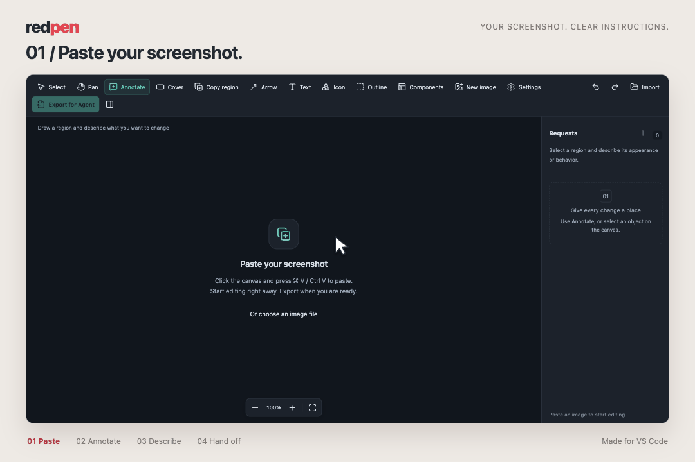
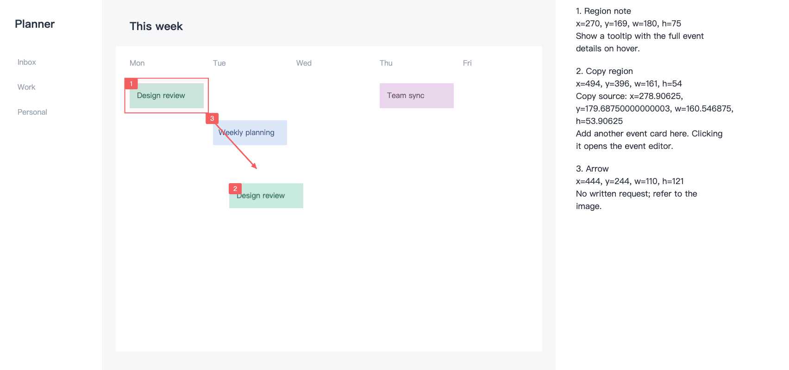

<!-- Purpose: provide the Traditional Chinese introduction and installation guide for redpen. -->
[English](README.md) | [繁體中文](README.zh-TW.md)

# redpen

**拿紅筆批改 AI 的 UI 答卷。**

把截圖貼進 VS Code 畫布，圈出問題、寫下需求，再交給 coding agent。
輕量、本機執行，不需要帳號或 AI API key，貼上就能開始。

## 在 VS Code 安裝

前往 [redpen 的 VS Code Marketplace 頁面](https://marketplace.visualstudio.com/items?itemName=yunn030123.redpen-ui-markup)，點擊 **Install**，依提示在 VS Code 中安裝。
也可以在 VS Code 開啟擴充功能頁（**⌘⇧X / Ctrl+Shift+X**），搜尋 `yunn030123.redpen-ui-markup` 安裝。

## 在 VS Code 開啟畫布

**不需要開啟任何資料夾或專案，在空白的 VS Code 視窗就能編輯。** 不用設定 Node.js、執行建置指令，也不需手動安裝 VSIX。

1. **開啟畫布**：在 VS Code 按 **⌘⇧P**（macOS）或 **Ctrl+Shift+P**（Windows/Linux）開啟命令面板，搜尋 **redpen: Open Canvas**，按 Enter。出現 **redpen Canvas** 分頁後就能開始，不用先命名或儲存稿件。
2. **貼上截圖**：點一下畫布，再按 **⌘V / Ctrl+V**；或按 **Import** 選取 PNG、JPEG、WebP。也能在檔案總管對圖片按右鍵 → **redpen: Open Canvas**。
3. **描述修改**：選 **Annotate**，框選要改的區域，在註解浮窗輸入需求。也能用遮蓋、箭頭、文字、圖示和複製區塊畫出修改結果。
4. **匯出**：按 **Export for Agent**，選擇位置，儲存成一個 SVG。
5. **交給 agent**：在 VS Code 匯出成功通知按 **Copy handoff prompt**，再貼進 agent 對話。Prompt 會包含 SVG 路徑；若 agent 無法讀取該路徑，請一併附上 SVG。

首次使用會跳出引導通知，按 **Open guide** 開啟指南。之後可執行 **redpen: Show Getting Started** 再次查看。

*影片統一以英文呈現，使用實際畫布錄製；最後的 agent 交接畫面為示意。*

## 一個檔案，三個圖層

SVG 包含 **original 原圖、modified 修改物件、annotations 註解** 三層，編號需求直接排在畫面旁。
匯入 redpen 就能繼續編輯；匯出範圍會自動涵蓋所有物件，截圖外的空白維持透明。

## 小技巧

- **懸浮工具列**：繪圖工具放在左上；復原、匯入、匯出和 Requests 開關放在右上。Requests 預設收起，展開後與右上工具列相連，浮在畫布上。
- **收合工具**：按 **Collapse drawing tools**，收起時只顯示目前工具；懸停或鍵盤聚焦時展開，偏好會記住。縮放控制改放左下直排。
- **手繪圖示**：畫下筆畫後灰色佔位底消失，匯出的 SVG 也只保留筆畫；清除筆畫後恢復佔位底。
- **畫布註解**：懸停在編號註解圖示上查看需求，點文字框即可編輯。打字時浮窗會保持開啟，按 Escape 或離開欄位套用變更；**More options** 可開啟側欄。

- **貼上新圖**：新增可移動的圖片物件；雙擊底圖再貼上，只替換底圖，原有物件位置不變。
- **選取與編輯**：使用 Select 拖曳多選，⌘/Ctrl 點擊切換選取；拖曳箭頭端點調整長度與方向，Delete 刪除物件。
- **側欄工具**：旋轉、鏡像圖片；Requests 旁的 **＋** 可新增整體需求。
- **復原／重做**：⌘/Ctrl Z／⌘/Ctrl Shift Z。新畫布會自動暫存在本機。

## 通知與稿件

- 通知統一以 **redpen:** 開頭。匯出成功可按 **Copy handoff prompt**；錯誤會提示需要修正的問題。取消儲存視窗不會匯出檔案。
- 錯過匯出通知？到畫布 **Settings → Copy handoff prompt** 複製，也能在這裡修改 prompt；`{svgPath}` 會填入匯出檔案路徑。
- 新畫布自動暫存在本機。內部 `.redpen.json` 是編輯稿件，交給 agent 時使用匯出的 SVG。
- 按 **Import** 匯入 redpen SVG，即可繼續編輯。若舊稿件顯示成 JSON，選 **Reopen Editor With… → redpen Canvas**。

## License

[MIT](LICENSE) · [第三方授權](THIRD_PARTY_NOTICES.md)
